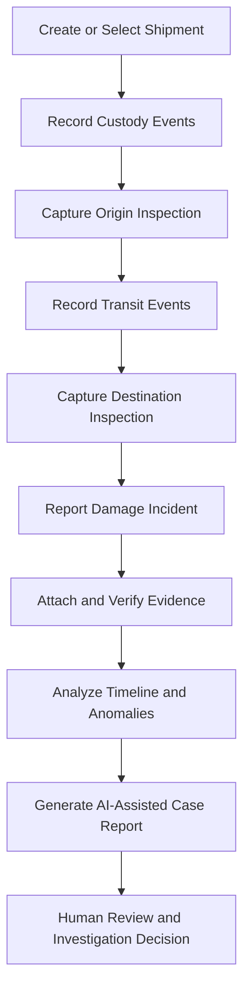
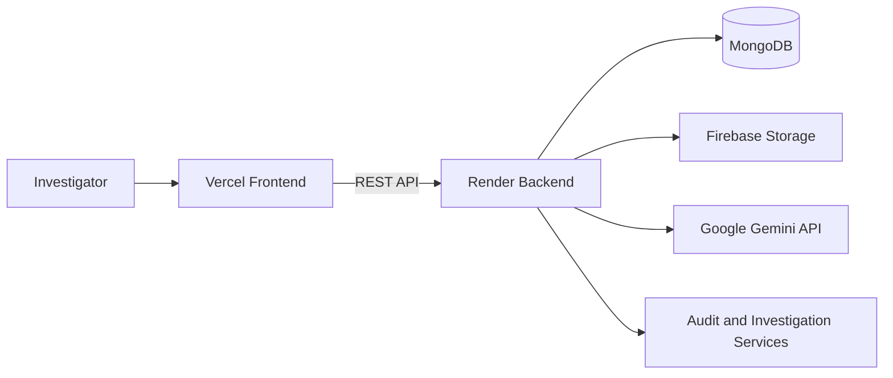

# CargoTrace
### Evidence-Grounded Cargo Damage Investigation & Responsibility Analysis

**Investigate where cargo damage may have occurred. Connect custody records, inspections, incidents, and evidence into a traceable investigation.**

<p align="center">
  <a href="https://cargo-trace-6pzc.vercel.app/"><strong>🚀 Live Demo</strong></a>
  &nbsp; · &nbsp;
  <a href="https://github.com/adityanimkar137/CargoTrace"><strong>📂 GitHub Repository</strong></a>
</p>

---

## Overview

CargoTrace is a logistics investigation platform designed to help organizations investigate damaged shipments and understand where damage may have occurred during transportation.

Cargo frequently passes through multiple parties, including loaders, drivers, transit hubs, and receiving teams. When damage is discovered at the destination, determining when it occurred can be difficult because custody records, inspection reports, photographs, and incident records are often fragmented across different systems.

CargoTrace brings these investigation records together into a structured workflow. It connects shipment custody history with physical inspections, damage incidents, supporting evidence, timeline analysis, anomaly detection, and AI-assisted case reporting.

The objective is to make investigations more **traceable, evidence-grounded, auditable, and easier to review**.

## The Problem

Traditional cargo damage investigations face several challenges:

- **Fragmented evidence:** Photographs, inspection findings, incident reports, and custody records may be stored separately.
- **Unclear damage chronology:** Teams may disagree about when damage first appeared or which custody transition requires further investigation.
- **Incomplete records:** Missing inspections or gaps in custody history make conclusions harder to support.
- **Conflicting information:** Recorded events and physical inspection findings may not tell a consistent story.
- **Slow investigations:** Investigators must manually correlate records and prepare reports.
- **Weak accountability trails:** Investigation decisions and explanations need to remain traceable for subsequent review.

CargoTrace addresses these challenges by organizing the investigation around the shipment and its recorded evidence.

## Key Features

### 1. Shipment & Custody Tracking
- Organize investigations around individual shipments.
- Record custody events across the transportation chain.
- Associate shipment activity with relevant locations, parties, and timestamps.
- Build a chronological view of recorded shipment movements.

### 2. Origin & Destination Inspections
- Record shipment condition at inspection points.
- Compare origin and destination inspection findings.
- Identify missing inspection information and condition differences.
- Use inspection records to help establish when damage was first documented.

### 3. Damage Incident Management
- Record damage incidents against shipments.
- Maintain incident details as part of the investigation.
- Link incidents with relevant inspections and other supporting records.
- Track unresolved relationships and review findings.

### 4. Evidence Management & Integrity
- Organize supporting evidence, including cargo and packaging photographs.
- Associate evidence with relevant investigation records.
- Use SHA-256 hashes to support file-integrity verification.
- Maintain traceable links between evidence and the records it supports.

*Hash verification supports integrity checking; it does not, by itself, establish when a file was created or prove that its contents are truthful.*

### 5. Investigation Timeline & Anomaly Detection
- Bring custody events and inspections into a chronological investigation view.
- Identify potential chronology inconsistencies.
- Highlight evidence gaps and missing relationships.
- Help investigators focus on records that need additional review.

### 6. AI-Assisted Case Analysis
- Generate structured investigation summaries using Google's Gemini models.
- Synthesize relevant shipment, custody, inspection, incident, and evidence records.
- Ground analytical findings in available recorded evidence.
- Include evidence references and citation validation in the case-analysis workflow.
- Support report generation for investigation review.

AI-generated findings are intended to support human investigation, not replace it. They do not independently establish legal liability or prove which party caused the damage.

### 7. Investigation Review & Auditability
- Record investigator review decisions and explanatory notes.
- Track unresolved findings and record-linkage issues.
- Maintain audit events for supported user and investigation actions.
- Generate structured case reports, including PDF output.

### 8. Authentication & Organization Isolation
- Support user registration and authentication.
- Organize users and work within separate organizations.
- Apply role-based access control for administrative and investigation workflows.
- Use server-side permission checks and persisted session records.

Available roles include **Admin, Investigator, Reviewer, and Viewer**.

## Investigation Workflow



The workflow connects recorded events and supporting evidence so that investigators can examine the available facts, identify gaps, and document their reasoning.

## Technology Stack

| Layer | Technologies |
|---|---|
| Frontend | React 19, Vite, JavaScript |
| Styling | Tailwind CSS v4 |
| Backend | Node.js, Express.js |
| Database | MongoDB, Mongoose |
| Authentication | Password hashing, persisted sessions, role-based access control |
| AI Analysis | Google Gemini API |
| Evidence Storage | Firebase-based image storage |
| PDF Reporting | jsPDF, jsPDF-AutoTable |
| Icons | Lucide React |
| Frontend Deployment | Vercel |
| Backend Deployment | Render |
| Version Control | Git, GitHub |

## Architecture

CargoTrace separates the frontend from the backend to keep the user interface, business logic, data persistence, and AI-assisted analysis independently maintainable.



**Frontend:** Provides the shipment workspace, investigation views, evidence interfaces, and report-generation experience.

**Backend:** Handles API requests, authentication, organization access, permissions, shipment records, investigation logic, and report generation.

**MongoDB:** Persists application records, including users, organizations, memberships, sessions, custody events, and investigation data.

**Firebase Storage:** Stores supported evidence files independently of the application database.

**Gemini:** Assists with structured case analysis based on the information supplied by the application.

## Security & Data Integrity

CargoTrace incorporates security and traceability measures relevant to multi-user investigation workflows:

- Password hashing rather than plaintext password storage.
- Server-side role and permission enforcement.
- Organization-scoped access to application data.
- Persisted session management with expiration.
- Audit records for supported actions.
- SHA-256 evidence integrity checks.
- Environment-based configuration for credentials and service endpoints.

These mechanisms help strengthen application security and traceability. Production readiness still depends on correct deployment configuration, authorization testing, secret management, and validation of every relevant API route.

## Getting Started

### Prerequisites

- Node.js and npm
- MongoDB instance
- Firebase project configured for evidence storage
- Google Gemini API key for AI-assisted analysis

### 1. Clone the Repository

```bash
git clone https://github.com/adityanimkar137/CargoTrace.git
cd CargoTrace
```

### 2. Configure the Backend

```bash
cd server
npm install
```

Create a `.env` file using the configuration template provided by the backend, if available.

Configure the required environment variables for:

- MongoDB connection
- Session and authentication secrets
- Frontend origin / CORS
- Gemini API access
- Firebase credentials and storage

Use the actual variable names expected by the server implementation. Never commit real credentials, service-account files, or production secrets.

Start the backend using the script defined in `server/package.json`, for example:

```bash
npm run dev
```

### 3. Configure the Frontend

Open a second terminal:

```bash
cd client
npm install
```

Create `client/.env` with the backend API base URL:

```env
VITE_API_BASE_URL=http://localhost:5000/api/v1
```

Use the actual backend port configured by your local server. Vite-exposed variables are bundled into the client, so never put private API keys or server credentials in `VITE_*` variables.

Start the frontend:

```bash
npm run dev
```

Open the local URL printed by Vite in your terminal.

### 4. Production Deployment

The deployed application uses:

- **Frontend:** [CargoTrace on Vercel](https://cargo-trace-6pzc.vercel.app/)
- **Backend:** [CargoTrace API on Render](https://cargotrace-6wgr.onrender.com)

Production configuration must point the frontend to the deployed API and allow the correct frontend origin on the backend. Configure secrets through the deployment platforms' environment-variable settings rather than committing them to GitHub.

## Project Structure

```text
CargoTrace/
├── client/
│   ├── src/
│   │   ├── lib/
│   │   ├── styles/
│   │   └── ...
│   ├── index.html
│   ├── package.json
│   └── vite.config.js
├── server/
│   ├── src/
│   │   └── modules/
│   ├── package.json
│   └── ...
├── src/
├── .gitignore
└── README.md
```

The `client/` directory contains the deployed React frontend, while `server/` contains the backend application and its modules. The root-level `src/` directory is retained as part of the repository's existing structure.

## Design Principles

- **Evidence before conclusions:** Findings should be connected to recorded information.
- **Traceable chronology:** Events should be examined in their recorded sequence.
- **Explicit uncertainty:** Missing or conflicting records should remain visible.
- **Human oversight:** AI output supports investigation rather than making final liability decisions.
- **Organization isolation:** Users should access only the data their permissions allow.
- **Auditability:** Important actions and review decisions should be traceable.

## Current Limitations

- Analytical quality depends on the completeness and reliability of recorded evidence.
- AI-generated analysis can be incomplete or incorrect and requires human review.
- A hash can detect changes relative to a trusted reference hash, but does not independently prove the origin or authenticity of evidence.
- The platform supports investigation and responsibility analysis; it does not guarantee a legally conclusive attribution of damage.
- Availability and functionality of external services depend on their configuration and operational status.

## Future Scope

Potential improvements include:

- More advanced custody-chain and chronology validation.
- Stronger evidence provenance and verification workflows.
- Additional investigation review and export capabilities.
- Automated regression tests for authentication, tenant isolation, and evidence linkage.
- Improved operational monitoring and production deployment hardening.


---

*CargoTrace is a software project for evidence-organized cargo damage investigation and decision support. AI-generated findings are advisory and should be independently reviewed.*
